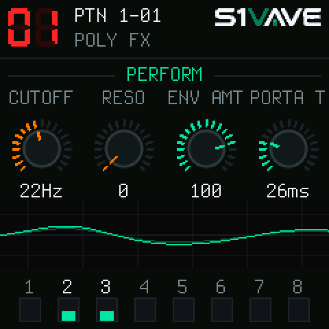

# S1Vave — 8-Voice Virtual Analog Tweak Synth for M-VAVE FM-1

[](LICENSE)
[](docs/PANEL_GUIDE.md)
[](docs/HANDOVER.md)

**S1Vave** is an open-source firmware that transforms the portable **M-VAVE FM-1** synthesizer hardware (JieLi AC791N 32-bit RISC MCU) into an 8-voice virtual analog tweak synth modeled after the classic SH-101 and S-1 architecture.

Every aspect—from the classic oscillator core and sub-oscillator waveshapes, to the cascaded 4-pole filter with self-oscillation, calibrated ADSR envelope curves, unique **OSC DRAW** and **OSC CHOP** sound manipulation, multi-waveform LFO with audio-rate Fast mode, stereo effects suite, and 1:1 MIDI CC implementation—has been modeled and calibrated to provide complete sound engine parity.

<p align="center"></p>

---

## Highlights & Features

### 1. Classic SH-101 Voice Architecture & Tweak Innovations
- **Polyphony & Voicing Modes (8-Voice Engine)**:
  - `MONO`: True SH-101 monosynth with legato glide (auto-portamento).
  - `UNISON`: 8-voice stacked unison with massive analog lead and bass presence.
  - `POLY`: 8-voice dynamic polyphony for rich chords and lush pads.
  - `CHORD`: Programmable chord memory with independent voice shifts (-12 to +12 semitones).
- **Oscillator Core**:
  - **Sawtooth**: PolyBLEP anti-aliased classic saw.
  - **Square / Pulse**: Wide-range Pulse Width Modulation (PWM) from 50% square down to ~5% needle pulse. Modulated via Manual duty cycle, Envelope sweep, or LFO.
  - **Sub-Oscillator**: 3 authentic octave types:
    - `-2o.A`: 2 octaves below, 25% asymmetric duty cycle (signature SH-101 growl).
    - `-2oc`: 2 octaves below, 50% symmetric square wave.
    - `-1oc`: 1 octave below, 50% symmetric square wave.
  - **Noise Generator**: Calibrated **Pink Noise** (analog 12 dB/oct roll-off above 1.8 kHz) and **White Noise**.
- **Unique Wave-Shaping Features**:
  - **OSC DRAW**: 16-step wavetable drawing (`STEP` mode for raw digital textures or `SLOPE` for smooth interpolated waves), with a `1.0x` to `32.0x` frequency multiplier.
  - **OSC CHOP**: Harmonic comb slicing (`1.0` to `32.0` repetitions) with overtone depth control (0–200, $>100$ phase inverted) to create metallic overtones and bell-like timbres.
  - **Riser / Downer**: Built-in performance transition sweep generator (`SYNC`, `QUIV`, and `QV.PAN` modes) for sweeping rises, risers, and dropouts.

---

### 2. Cascaded 4-Pole Filter & Calibrated Envelopes
- **4-Pole (24 dB/oct) Cascaded State-Variable Filter**:
  - Full $20\text{ Hz} \dots 20\text{ kHz}$ calibrated cutoff curve matching the S-1 hardware pot response.
  - Smooth analog resonance with self-oscillation and bass retention.
  - Keyboard tracking ($0\% \dots 100\%$) and bipolar filter envelope modulation.
  - Dual filter character modes: **S-1 Clean Roland ACB** and **Warm Midnight** soft-knee drive.
- **Calibrated ADSR Envelopes**:
  - Precise exponential analog RC attack, decay, sustain, and release curves measured from the Roland S-1 hardware.
  - Envelope trigger modes: `GATE`, `GATE+TRIG` (re-triggers on overlapping notes), and `LFO` (cyclic re-triggering).
  - Amp envelope mode: Instant `GATE` (organ style) or dynamic `ENV` (ADSR shaped).

---

### 3. Modulation & Effects
- **Versatile LFO Engine**:
  - 6 Waveforms: Sawtooth, Inverted Sawtooth, Triangle, Square, Random (S&H), and Noise.
  - Speed range: $0.05\text{ Hz} \dots 30\text{ Hz}$ in Normal mode, and up to $\sim 100\text{ Hz}$ in **Fast audio-rate mode**.
  - Tempo Sync: Locked to MIDI clock across 31 musical note divisions ($8/1$ to $1/128$ triplets/dotted).
  - Key Trigger: Option to reset LFO phase on note-on.
- **Stereo FX Suite**:
  - **Stereo Chorus**: 4 chorus models (Type 1–4) with Hermite-interpolated delay lines.
  - **Tempo-Synced Delay**: Stereo ping-pong delay with analog tape slewing when changing delay time and feedback tone filtering.
  - **Plate Reverb**: High-density Dattorro figure-of-8 reverberator running at the full 44.1 kHz sample rate (7 room types: Ambient, Room, Hall 1, Hall 2, Plate, Spring, Mod).

---

### 4. Sequencer, Presets & USB Connectivity
- **Dual-Track 64-Step Sequencer**:
  - Two polyphonic tracks (A and B) sharing 256 steps with independent length, clock division, swing, and transpose for complex polymeters.
  - Step entry with piano roll view, live recording, sub-step ratchets (1–4), per-step probability, and motion recording.
  - 8 pattern slots saved directly in flash memory.
- **99 Presets & Instant Recall**:
  - Programs 1–64 come pre-loaded with authentic factory sounds and patterns; slots 65–99 are available for user programs.
  - Startup recall sequence preserves custom OSC DRAW wavetables and OSC CHOP comb masks.
  - Direct bidirectional SysEx patch dump & restore support over USB-MIDI.
- **Enhanced Arpeggiator & Hold**:
  - Press and hold `ARP` button (450 ms) to toggle `HOLD` latch mode instantly.
  - Dedicated Arp page (`Mode`, `Hold`, `Type`, `Rate`) and Arp Config page (`Note Priority: Low / Last`).
  - Seamless key release and retrigger behavior in latch/hold mode.
- **Dynamic Battery Level Monitoring**:
  - Real-time SARADC battery tracking with 4-bar hysteresis and visual low-voltage blinking alert in the status bar header.
- **S-1 Parity Velocity & Key Follow**:
  - Dynamic velocity sensitivity scaling for VCA amplitude (~18 dB musical dynamic range).
  - True 1V/oct chromatic filter keyboard tracking (scaled to Q8 semitones).
- **USB-Audio & Class-Compliant USB-MIDI**:
  - 44.1 kHz / 16-bit stereo USB Audio with zero-glitch ring buffering.
  - Complete 1:1 MIDI Control Change implementation chart.

---

## Hardware Panel Controls (M-VAVE FM-1)

The M-VAVE FM-1 has 4 push-encoders (`K1`–`K4`), 8 function buttons, and 16 step keys. Tapping any button brings up its page:

| Page / Button | KNOB 1 (`K1`) | KNOB 2 (`K2`) | KNOB 3 (`K3`) | KNOB 4 (`K4`) |
|:---|:---|:---|:---|:---|
| **HOME (PERFORM)** | Cutoff (FREQ) `[CC 74]` | Resonance (RESO) `[CC 71]` | Env Depth (ENV) `[CC 24]` | Portamento Time `[CC 5]` |
| **EDIT (OSC CORE)** | Range (64'..2') `[CC 14]` | Square Level `[CC 19]` | Saw Level `[CC 20]` | Sub Level `[CC 21]` |
| **EDIT (PWM)** | PWM Source `[CC 16]` | Pulse Width / Duty `[CC 15]` | Square Level `[CC 19]` | Sub Octave Type `[CC 22]` |
| **EDIT (SUB/NOISE)** | Sub Type (`-2o.A`, `-2oc`, `-1oc`) | Noise Level `[CC 23]` | Noise Mode (Pink/White) | Fine Tune `[CC 76]` |
| **EDIT (OSC DRAW)** | Draw Switch (Off/Step/Slope) | Multiply (1.0x–32.0x) | PWM Source `[CC 16]` | Pulse Width `[CC 15]` |
| **EDIT (OSC CHOP)** | Chop Overtone (0–200) `[CC 103]` | Chop Comb (1.0–32.0) `[CC 104]` | — | — |
| **EDIT (FILTER)** | Filter Cutoff `[CC 74]` | Filter Resonance `[CC 71]` | Filter LFO Depth `[CC 25]` | Key Follow (0–100%) `[CC 26]` |
| **ENV (ADSR)** | Attack `[CC 73]` | Decay `[CC 75]` | Sustain `[CC 30]` | Release `[CC 72]` |
| **ENV (TRIG/AMP)** | Env Trigger Mode `[CC 29]` | Amp Mode (Gate/Env) `[CC 28]` | PWM Source `[CC 16]` | PWM Depth `[CC 15]` |
| **LFO (CORE)** | LFO Rate `[CC 3]` | Waveform `[CC 12]` | Tempo Sync `[CC 106]` | Fast Mode `[CC 79]` |
| **LFO (ROUTING)** | Pitch LFO Depth `[CC 13]` | Filter LFO Depth `[CC 25]` | PWM Depth `[CC 15]` | Key Trigger `[CC 105]` |
| **LFO (RISER)** | Riser Mode (Sync/Quiv/Pan) | Riser Resonance | Riser Shape | Riser Level |
| **FX (MIX)** | Chorus Mode `[CC 93]` | Delay Level `[CC 92]` | Reverb Level `[CC 91]` | Delay Time `[CC 90]` |
| **FX (DELAY)** | Delay Level `[CC 92]` | Delay Time `[CC 90]` | Delay Feedback | Delay Tempo Sync |
| **FX (REVERB)** | Reverb Level `[CC 91]` | Reverb Time `[CC 89]` | Reverb Type (Plate..Mod) | Chorus Mode `[CC 93]` |
| **GLO (VOICE)** | Poly Mode (Mono..Chord) `[CC 80]` | Portamento Mode `[CC 31]` | Transpose `[CC 77]` | Master Volume `[CC 7]` |

> For the full button layer combinations, arpeggiator operations, and step sequencer instructions, see the [Hardware Panel Guide](docs/PANEL_GUIDE.md).

---

## Complete MIDI CC Implementation

S1Vave maps parameters 1:1 to the S-1 MIDI specification:

- `CC 1`: Mod Wheel (LFO Depth)
- `CC 3`: LFO Rate
- `CC 5`: Portamento Time
- `CC 12`: LFO Waveform
- `CC 13`: OSC Pitch LFO Depth
- `CC 14`: OSC Range (64'..2')
- `CC 15`: PWM Depth / Pulse Width
- `CC 16`: PWM Source (0=ENV, 1=MAN, 2=LFO)
- `CC 19`: Square/Pulse Level
- `CC 20`: Saw Level
- `CC 21`: Sub Level
- `CC 22`: Sub Octave Type (0=-2o.A, 1=-2oc, 2=-1oc)
- `CC 23`: Noise Level
- `CC 24`: Filter Env Depth
- `CC 25`: Filter LFO Depth
- `CC 26`: Filter Key Tracking
- `CC 28`: Amp Env Mode (0=Gate, 1=Env)
- `CC 29`: Env Trigger Mode (0=LFO, 1=Gate, 2=Gate+Trig)
- `CC 30`: Envelope Sustain
- `CC 31`: Portamento Mode (0=Off, 1=On, 2=Auto)
- `CC 71`: Filter Resonance
- `CC 72`: Envelope Release
- `CC 73`: Envelope Attack
- `CC 74`: Filter Cutoff Frequency
- `CC 75`: Envelope Decay
- `CC 76`: Fine Tune
- `CC 77`: Key Transpose
- `CC 78`: Noise Mode (0=Pink, 1=White) / Riser Mode
- `CC 79`: LFO Speed Mode (0=Normal, 1=Fast)
- `CC 80`: Poly Mode (0=Mono, 1=Unison, 2=Poly, 3=Chord)
- `CC 89`: Reverb Time
- `CC 90`: Delay Time
- `CC 91`: Reverb Level
- `CC 92`: Delay Level
- `CC 93`: Chorus Mode (0=Off, 1..4=Type 1..4)
- `CC 102`: OSC DRAW Multiply (1.0x–32.0x)
- `CC 103`: OSC CHOP Overtone (0–200)
- `CC 104`: OSC CHOP Comb (1.0–32.0)
- `CC 105`: LFO Key Trigger (0=Off, 1=On)
- `CC 106`: LFO Tempo Sync (0=Off, 1=On)
- `CC 107`: OSC DRAW Switch (0=Off, 1=Step, 2=Slope)

> For the comprehensive MIDI CC list and value ranges, see the [MIDI CC Implementation Guide](docs/MIDI_CC.md).

---

## Flashing & Installation

### Option 1: Quick Install via Python (Recommended)
Connect your M-VAVE FM-1 via USB-C to your computer:

```bash
python tools/fm1_install.py build/s1vave-1.1.fwsc --yes
```

The script communicates over USB HID, validates checksums, flashes the firmware sector by sector (~2 minutes), and automatically reboots the hardware into S1Vave.

### Option 2: Web Installer
You can also install S1Vave with one click via WebUSB / WebMIDI on [thefirmwarehub.com](https://thefirmwarehub.com).

---

## Browser Simulator & Web Calibration Studio

Experience the firmware directly in your web browser with the WebAssembly simulation:

1. Build the WebAssembly binary:
   ```bash
   sh web/sim/build.sh
   ```
2. Start the local server:
   ```bash
   python3 -m http.server 8737 -d docs/sim
   ```
3. Open `http://localhost:8737/` to interact with the virtual LCD, encoders, buttons, and play notes from your computer or MIDI keyboard.
4. Open `http://localhost:8737/editor/` to access the **Dual Synth Calibration Studio** for side-by-side A/B acoustic comparisons.

---

## Building from Source (Linux / WSL2)

### 1. Prerequisites
```bash
sudo apt update
sudo apt install -y python3 python3-pip git build-essential pipewire alsa-utils
pip3 install Pillow mido python-rtmidi
```

### 2. Download Toolchain
```bash
cd s1vave-main
./tools/get_toolchain.sh
```

### 3. Clone JieLi AC79 SDK
```bash
git clone --depth 1 --branch AC79NN_SDK_V1.2.1_2023-12-13 https://gitee.com/Jieli-Tech/fw-AC79_AIoT_SDK.git ~/fw-AC79_AIoT_SDK
```

### 4. Compile Firmware Package
```bash
./build.sh --release 1.1
```

The build pipeline enforces strict JieLi AC791N hardware rules (integer-only fixed-point DSP, prohibition of 64-bit software divisions, and ROM collision prevention). The resulting `.fwsc` firmware binary will be placed at `build/s1vave-1.1.fwsc`.

---

## Documentation Links

- **[Technical Handover & Calibration Guide](docs/HANDOVER.md)**: Deep dive into the DSP equations, fixed-point math, acoustic calibration measurements, volume staging, and USB audio buffer watermarks.
- **[Hardware Panel & Navigation Guide](docs/PANEL_GUIDE.md)**: Complete guide to all physical knobs, buttons, layers, and sequencer views.
- **[MIDI CC Implementation Chart](docs/MIDI_CC.md)**: Complete reference of all supported MIDI Control Changes.
- **[JieLi AC791N Hardware Rules](docs/RULES.md)**: Architectural and compiler rules for developing firmware on the AC791N RISC MCU.
- **[Licensing & Credits](LICENSING.md)**: Upstream credits, contributors, and open-source licenses.

---

## Credits & License

**S1Vave** is free software released under the **GNU General Public License v3.0** (`GPL-3.0-only`). See [LICENSE](LICENSE) and [LICENSING.md](LICENSING.md).

- **Parity Sound Engine, DSP Calibration & Visual Branding**: [Andrew GG](https://github.com/AndrewGG88)
- **OberVave Synthesizer & Dinghy Platform**: [zvenson](https://github.com/zvenson/obervave) (original OberVave codebase and Dinghy platform wiring)
- **Felucca Base Platform**: [Leo Kuroshita](https://github.com/hugelton/Felucca) (@kurogedelic), Hügelton Instruments
- **SLOOP Platform Contributions**: [isod89](https://github.com/isod89/sloop-fm1)
- **SMK-37 Port**: [M. Geisler](https://github.com/genkigenki/sloop-fm1/tree/smk37)

*Roland, AIRA, AIRA Compact, S-1, and SH-101 are trademarks of Roland Corporation. M-VAVE, FM-1, and SMK-37 are trademarks of Shenzhen Sincoo Technology Co., Ltd. S1Vave is an independent community project and is not affiliated with or endorsed by Roland Corporation or Shenzhen Sincoo Technology Co., Ltd.*
