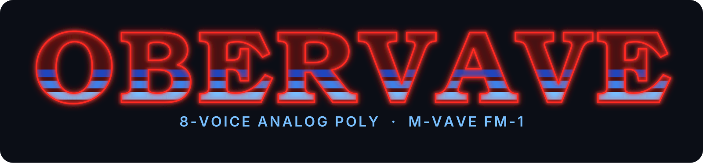

<p align="center"></p>

# OberVave

**One 8-voice analog-style polysynth for the M-VAVE FM-1, with chorus, delay and a plate reverb.**

OberVave turns the FM-1 into a single, deep instrument in the spirit of the classic American 8-voice poly synths of
1979-84: two oscillators a voice with hard sync and cross-modulation, a 12 / 24 dB filter with an SEM-style
lowpass-to-highpass morph, two envelopes, an LFO, an arpeggiator, a two-track step sequencer, 99 programs (64 factory sounds), and
three effects after the voices. No second engine: one synth, as far as the chip goes.

<p align="center"></p>

> **Status: 1.5, runs on the FM-1.** Install it from [thefirmwarehub.com](https://thefirmwarehub.com) or with
> `tools/fm1_install.py docs/firmware/obervave-1.5.fwsc` (identity `FM-1_955`). 1.5 has 99 program slots: 64 factory
> sounds (32 new ones on 33-64: arpeggios, brass, pads, keys, basses, leads, effects), 65-99 start as INIT. SAVE now
> saves anywhere: tap SAVE, turn PRESETS to the slot (the header shows its number and what is there), tap SAVE again.
> The programs saved with 1.4 come along on the first start.
> 1.4.3 gave each sound its own HOLD:
> the arp of track A and of track B latch on their own (one's HOLD held the other's notes, one's HOLD off stopped both).
> 1.4.2 kept the notes in time while
> the screen redraws (they stumbled under CC streams and live tweaking; chords on the SMK-37 came in staggered).
> 1.4.1 gave each sound its own
> arpeggiator (in 1.4 track B's sound did not arpeggiate). 1.4 gave track B a sound of its own
> (two sounds on the eight voices, see [the sequencer](#the-sequencer)) and opens the sequencer on TRACKS, A and B one
> under the other as in SLOOP. 1.3.1 coloured the sequencer by track (A blue, B orange). 1.3 gave the sequencer the whole
> screen and works it as SLOOP's step page (KNOB 1 moves the step cursor, the keys write into it), and switches and
> saves patterns as zp12 does its loops (see [the sequencer](#the-sequencer)). Do not install 1.1: its USB-MIDI out is
> broken, and once it runs no installer gets another firmware back on (1.2 fixed it).

**Play it in your browser:** `docs/sim/` is the firmware itself (the same C sources, compiled to WebAssembly) with
the FM-1's screen, keys, buttons and knobs, your computer keyboard or a MIDI keyboard. Build it with
`sh web/sim/build.sh`, try it with `python3 -m http.server -d docs/sim` (see `web/sim/build.sh` for the two tools).

**M-Vave SMK-37:** see [SMK-37 instructions](SMK37.md).

Hear it: [the video](video/) is nine OberVaves (the host build) playing one slow, dark track; every sound in it,
drums included, is this firmware.

## The synth

| | |
| --- | --- |
| **Voices** | 8. POLY (round-robin, steals the oldest released), DUAL (2 detuned voices a note), UNISON (2-8 voices, detune and pan spread), MONO (last note, legato). Glide in every mode. |
| **Oscillators** | 2 a voice: saw, pulse, saw+pulse, off. Pulse width and PWM. OSC 2: ±24 semitones, fine detune, hard sync to OSC 1, filter envelope to pitch (sync sweeps), X-MOD (OSC 2 → OSC 1 linear FM). Noise. PolyBLEP anti-aliasing, free-running phases. |
| **Filter** | State-variable, trapezoidal: LP 12, HP 12, BP 12, notch, LP 24 (two cascaded), SEM (LP → notch → HP by MORPH). Cutoff, resonance with a soft, bounded self-oscillation, envelope amount (bipolar), key tracking, velocity, drive before the filter. |
| **Envelopes** | Filter ADSR and amp ADSR with analog RC curves, 0.5 ms to 10 s. |
| **LFO** | Triangle, saw, ramp, square, S&H, smooth random; 0.05 to 30 Hz; delay / fade-in; phase SYNC / FREE / SPREAD (an offset per voice). To pitch (OSC 1 / 2 / both), PWM, filter, amp. The mod wheel adds vibrato and filter. |
| **Vintage** | Each of the 8 voice cards has its own small tune, cutoff and envelope offsets, plus a slow random walk on pitch, all scaled by one knob. SPREAD pans the cards like the originals' pan pots. |
| **Effects** | Chorus (two taps, Hermite-interpolated). Ping-pong delay in note values of the tempo (1/16 to 1/2, dotted and triplet), with feedback tone; the time slews like a tape when it changes. Plate reverb (Dattorro's figure-of-eight tank) at the full sample rate: SIZE, DAMP, PRE-DLY, MIX. |
| **Arpeggiator** | UP, DOWN, UP/DN, RANDOM, AS PLAYED; 1-4 octaves; 1/4 to 1/32 with triplets; gate; latch (HOLD). Sample-exact, in the audio interrupt. Follows MIDI clock. |
| **Sequencer** | Two tracks that share 256 steps (one track can have them all, or A and B split them). A step is a chord of up to 4 notes with velocity, gate or a tie into the next step, a ratchet (1-4 hits) and a chance. Each track has its own length (polymeters), note value (1/4 to 1/32 with triplets), swing and transpose, and can be muted. Step recording on its own full screen (a step cursor on KNOB 1, chords from the keys or MIDI, rests, ties) and live recording into the running loop, quantized to the nearest step. 8 patterns in flash, switched at the loop's end while it plays, saved by themselves. Sample-exact in the audio interrupt, follows MIDI clock, start and stop. Track B plays the OberVave sound of track A, or a sound of its own (any of the 99 programs, kept with the pattern): two sounds on the eight voices. |
| **Programs** | 32: factory set in flash, your saves in the settings sector. 01 DARK ARP, 26 UPSIDE ARP, 29 NEON PAD are the dark ones; brass, strings, leads, basses, bells, pads, drums-from-a-filter for the rest. Hold SAVE and press the SELECT knob for a new one at random, within useful ranges. |
| **MIDI** | USB-MIDI in and out. Notes, velocity, pitch bend (range 0-24), program change, sustain, mod wheel, clock / start / continue, MIDI channel or OMNI (with a channel set, the next channel plays track B's own sound: notes, CC, program change). CC 74 cutoff, 71 resonance, 73 / 72 amp attack / release, 5 glide, 1 mod depth, 7 volume, 64 sustain, 120 / 123 all off; every other parameter from CC 20 up in the order of the parameter table (see `firmware/src/obv_params.h` and CLAUDE.md). |

Integers only: the chip has no FPU. The whole engine is fixed point, the tables are generated by
`tools/gen_tables.py` and committed.

## The panel

The panel works as sloopDX's: **tap** a function button (press and let go, touching nothing else) and its pages
open; **hold** it and it is a **layer**: the white keys and the knobs change job until you let go. **HOME** tapped
while a layer is held locks it open; its button lets it go.

| Hold | Keys | KNOB 1 · 2 · 3 · 4 | Tap |
| --- | --- | --- | --- |
| **SEQ** | steps 1-16 of the page (tap: set with the last note or chord / clear; hold + a later step: one long note); black keys F#3 .. A#4: page 1-8 | NOTE · DIV · SWING · LENGTH; a step held: NOTE · LEVEL · RATCHET · GATE | the sequencer (full screen); again: its next view |
| **EDIT** | erase that note (playing: as the playhead passes) | SHIFT · LENGTH x2 / 1/2 · TRANSPOSE | OSC / FILTER pages |
| **GLO** | 1 / 2 mute track A / B, 5 / 6 solo, G5 tap tempo | - | GLOBAL (TEMPO, CLICK, MIDI CH, TUNE; the CPU time in its title) / VOICE / OUTPUT |
| **SAVE** | white 1-8: go to pattern 1-8; black 1-8 (F#3 .. A#4): copy this pattern there (with SELECT pressed: a random sound) | - | twice: save the program (PRESETS in between: into another slot); in the sequencer: save the pattern now |
| **FX** | notes | CHORUS · DELAY · REVERB mix · DELAY TIME | CHORUS / DELAY / REVERB |

- **PLAY** start / stop (the light flashes on the beat). **REC** playing: record now on top (chords, held notes
  long) / stop; stopped: armed, the first note starts (CLICK on COUNT-IN: PLAY counts in a bar first). **REC held
  2 s** clears the track. The **click** (GLOBAL, KNOB 2): OFF, REC (while recording), ON, COUNT-IN; beat 1 higher, never
  recorded. **EDIT + OCT- / OCT+**
  undo / redo.
- **ALGORITHM** picks the track (A / B), **SELECT** is the tempo, **PRESETS** the program, **OCT- / OCT+** the
  octave (both: back to 0). **HOME** PERFORM (CUTOFF, RESO, ENV AMT, RELEASE). **ENV**, **LFO** their pages.
  **ARP** the arp page; on it the ARP button is HOLD (latch).
- The key LEDs show the notes that sound, the page buttons light for the page you are on, the eight round LEDs on
  the screen glow with each voice's envelope.

## The sequencer

**SEQ tapped** gives the sequencer the whole screen, as SLOOP's step page: a piano roll of the 16 steps around the
cursor (a bar per note: its width the gate, its brightness the velocity; the cursor red, the playhead blue), the
cursor step's notes and up to 64 steps as small cells, and the four knobs. Track A is drawn blue, track B orange (both
shown on top, the one you edit filled). SEQ tapped again steps through its views,
**HOME** leaves.

**Two tracks, two sounds.** Two note lanes, say a bass line on A and an arpeggio on B, each with its own length, DIV,
SWING and TRANSPOSE (16 steps against 12 makes a polymeter). **Track B starts switched off** (length 0). To start it:
SEQ tapped, **ALGORITHM** (the badge on top turns to B, orange), turn **KNOB 1**: B gets 16 steps; then play notes
into it or REC on top of A. GLO held + key 1 / 2 mutes A / B, + key 5 / 6 solos it.

**TRACKS** (as SLOOP's, the first view when SEQ is tapped) shows A and B one under the other: each with its sound,
its length and its 16 steps with the playhead. **ALGORITHM** picks the track (its row lights up), **PRESETS** picks
the track's sound. Track B plays track A's sound (`= A`) until you turn PRESETS up: it starts with A's program as its
own, then any of the 32 (outside the sequencer PRESETS does the same while track B is chosen). The pattern keeps which
program B plays, and a pattern switched in brings its B sound along. Both sounds share the eight voices (a MONO or
UNISON sound keeps four of them for itself).

- With track B chosen and its own sound, **the panel is on B's sound**: the program number and name turn orange
  with a B, the keys play it, every page edits it, PRESETS picks it, SAVE twice saves it into its program. ALGORITHM
  back to A and the panel is on sound A again.
- **Each sound has its own arpeggiator**: the ARP page sets the arp of the sound the panel is on, and both can run
  at once (A latched with HOLD, B played live). The **effects are sound A's**: B goes into them by its **FX SEND**
  (TRACKS, KNOB 4:
  100 % = all of it, as A; less, and the rest passes them by, dry: a bass under a big reverb stays tight).

| View | KNOB 1 | KNOB 2 | KNOB 3 | KNOB 4 |
| --- | --- | --- | --- | --- |
| **TRACKS** (PRESETS: the track's sound) | LENGTH | LEVEL | CUTOFF | FX SEND (B's own sound) |
| **STEPS** | the step cursor | NOTE (the chord moves) | GATE (to TIE) | VELOCITY |
| **STEP+** | the step cursor | RATCHET 1-4 | CHANCE | the step ON / OFF |
| **TRACK** | LENGTH (fast: by 16; A and B share 256) | DIV | SWING | TRANSPOSE |
| **PATTERNS** | the slot | - | GO there | COPY this one there (twice on a used one) |

- **Step entry** (STEPS, STEP+): a key or a chord goes into the cursor's step, and the cursor moves on when you let
  go; a key held and KNOB 1 turned on makes a long note. **EDIT tapped** clears the step (a rest). MIDI notes write
  too. **REC** records live, on every page.
- **ALGORITHM** picks track A or B. A track that is off (B at first) gets 16 steps from KNOB 1 on any view.
- **PRESETS** picks the pattern (1-8) on every view but TRACKS: stopped at once, playing from the end of track A's loop (the top line shows
  `PAT 1>2` until then). In the sequencer PRESETS is the pattern; HOME's pages keep it for the program.
- **Saving:** SAVE tapped saves now (playing: at the stop). A pattern also saves itself 3 s after a change once the
  sequencer stands (the `*` after `PAT 1` goes). One left with changes while playing is saved at the stop.
- **SAVE held + a white key 1-8** goes to that pattern, **+ a black key 1-8** copies this one there (start a
  variation that way).

## Build and run

OberVave is built on [Dinghy](https://github.com/zvenson/dinghy), whose platform (boot, USB, updates, audio, settings)
it keeps unchanged; the setup is Dinghy's (Linux x86-64, Python 3 with Pillow, the JieLi toolchain, three files of
the JieLi AC79 SDK: see Dinghy's README, "Set up once").

```sh
tests/run_host.sh                 # the synth on your computer: build/host/obervave.wav and screens as PNG
tests/run_host.sh my-script.txt   # your own keys / buttons / knob turns / MIDI over time (tests/host.c explains)
sh web/sim/build.sh               # the browser simulator: docs/sim (zig cc + wasm-opt), node tests/sim_test.mjs
./build.sh                        # the device package: build/obervave.fwsc
python3 tools/fm1_install.py build/obervave.fwsc   # onto the FM-1 over USB
```

The build refuses what would brick an FM-1 (a 64-bit division, a call into the chip ROM, too much RAM); the rules
are in `docs/RULES.md`, the platform calls in `docs/API.md`.

The video: `video/song.py` writes nine scripts, runs nine host instances filmed at 30 fps and mixes the stems;
`video/make_video.py` cuts the film. Both need only Python, NumPy, Pillow and ffmpeg.

## Credits and licence

GPL-3.0-only, see `LICENSE` and `LICENSING.md` for who made what. OberVave stands on
[Dinghy](https://github.com/zvenson/dinghy) (zvenson), which carries the FM-1 platform of
[Felucca](https://github.com/hugelton/Felucca) by Leo Kuroshita (Hügelton Instruments) with the changes of
[SLOOP](https://github.com/isod89/sloop-fm1) (isod89). The filter follows Andrew Simper's trapezoidal SVF, the reverb
Jon Dattorro's 1997 plate.

OberVave is inspired by the classic 8-voice poly synths of 1979-84 (Oberheim's OB-X and OB-8 era). Those names are
trademarks of their owners; OberVave is not made by or affiliated with them, and none of the marks appear in the
firmware. "M-VAVE" and "FM-1" belong to their owners too.
